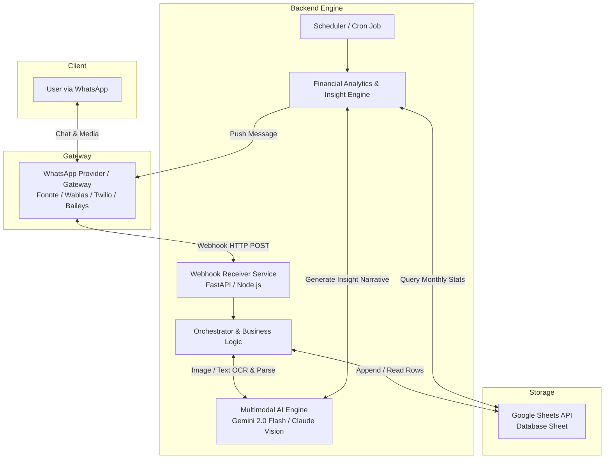

# Product Requirements Document (PRD)
## FinTrack-WA: Intelligent WhatsApp Expense Tracker & Financial Habit Analyzer

- **Versi**: 1.0.0
- **Status**: Ready for Implementation
- **Target Audience / Implementor**: AI Coding Assistant (Claude) / Software Engineer
- **Bahasa Utama**: Bahasa Indonesia

---

## 1. Executive Summary & Problem Statement

### 1.1 Latar Belakang
Mencatat pengeluaran harian sering kali gagal karena friksi yang tinggi (harus membuka aplikasi khusus, mengisi form berulang kali, atau mengetik manual). Di sisi lain, WhatsApp adalah aplikasi yang paling sering dibuka setiap hari di Indonesia.

### 1.2 Tujuan Produk
Membangun sistem *zero-friction expense tracker* berbasis WhatsApp:
1. Pengguna hanya perlu mengirim foto (struk fisik, screenshot mutasi m-banking, struk QRIS) atau pesan teks santai.
2. AI mengekstrak data transaksi secara terstruktur (nominal, kategori, merchant, metode pembayaran).
3. Data otomatis dicatat ke Google Sheets secara real-time.
4. Sistem menganalisis kebiasaan pengeluaran pengguna dan memberikan *feedback/insight* finansial otomatis secara berkala.

---

## 2. User Stories & Core Use Cases

| ID | User Story | Trigger Input | Expected Output |
|---|---|---|---|
| **US-01** | Pengguna ingin mencatat pengeluaran dari struk kertas/belanjaan | Foto struk belanja (Indomaret, resto, SPBU, dll.) | Data terurai masuk ke Google Sheets + balasan konfirmasi di WA |
| **US-02** | Pengguna ingin mencatat pengeluaran transfer/QRIS dari m-Banking | Screenshot bukti transfer (BCA, Mandiri, GoPay, OVO, ShopeePay) | Data terurai masuk ke Google Sheets + balasan konfirmasi di WA |
| **US-03** | Pengguna ingin mencatat pengeluaran tunai/cepat | Pesan teks: *"beli ketoprak 18rb tunai"* atau *"bensin 50k"* | Data terurai masuk ke Google Sheets + balasan konfirmasi di WA |
| **US-04** | Pengguna ingin membatalkan transaksi terakhir jika ada kesalahan | Pesan teks: *"Batal"* atau *"Hapus transaksi terakhir"* | Baris terakhir di Sheets dihapus/ditandai void + balasan konfirmasi |
| **US-05** | Pengguna ingin tahu status pengeluaran bulan ini secara instan | Pesan teks: *"Bulan ini habis berapa?"* atau *"Sisa budget makan?"* | Ringkasan statistik & progress budget dikirim ke WA |
| **US-06** | Pengguna ingin mendapatkan evaluasi kebiasaan belanja mingguan | Trigger waktu (Cron: Setiap Minggu pukul 20:00) | Laporan mingguan analitis dari AI + tips penghematan |

---

## 3. High-Level Architecture & Tech Stack



### Rekomendasi Tech Stack
- **Backend**: Python 3.11+ (FastAPI) atau Node.js / TypeScript (Express/Fastify)
- **WhatsApp Gateway**: 
  - *Cloud / SaaS*: Fonnte / Wablas (API resmi/semi-resmi lokal Indonesia) atau Twilio WhatsApp API
  - *Self-Hosted*: `@whiskeysockets/baileys` atau `whatsapp-web.js`
- **Vision & LLM**: Google Gemini Flash API (`gemini-2.0-flash` atau `gemini-1.5-flash`) karena biaya sangat rendah, native multimodal, dan paham konteks bahasa Indonesia & struk lokal.
- **Database**: Google Sheets via Google Sheets API v4 (`google-api-python-client` / `gspread`).
- **Scheduler**: APScheduler (Python) / Node-Cron.

---

## 4. Functional Specifications

### 4.1 Modul Input & Webhook Ingestion
1. Server menerima payload HTTP POST dari WhatsApp Gateway.
2. Payload divalidasi (memastikan nomor pengirim sesuai nomor terdaftar/whitelist untuk keamanan privasi).
3. Mendeteksi tipe pesan:
   - **Tipe Gambar**: Unduh *media stream*, simpan sementara (in-memory buffer atau temp file).
   - **Tipe Teks**: Ambil teks mentah.

### 4.2 Modul Ekstraksi AI (OCR & NLP Parser)
Model AI wajib menghasilkan output strictly valid JSON menggunakan mode **Structured Output / JSON Schema**.

#### Definisi Schema Output JSON:
```json
{
  "is_valid_transaction": true,
  "tanggal": "YYYY-MM-DD",
  "waktu": "HH:MM",
  "nominal": 45000,
  "kategori": "Makanan & Minuman",
  "merchant": "Kopi Kenangan",
  "deskripsi": "Beli Kopi Kenangan Mantan Large",
  "metode_pembayaran": "QRIS",
  "tipe_transaksi": "Pengeluaran",
  "confidence_score": 0.95
}
```

#### Standar Kategori yang Didukung:
- `Makanan & Minuman`
- `Transportasi` (Bensin, Ojol, Parkir, Tol)
- `Belanja Harian` (Supermarket, Minimarket, Pasar)
- `Tagihan & Utilitas` (Listrik, Air, Wifi, Pulsa/Data)
- `Hiburan & Lifestyle` (Bioskop, Game, Nongkrong, Langganan)
- `Kesehatan & Kebersihan` (Obat, Dokter, Skincare)
- `Pendidikan & Kerja` (Buku, Kursus, Alat Kantor)
- `Lain-lain`

#### Aturan Ekstraksi (Edge Cases Lokal Indonesia):
1. **Pajak & Diskon**: Ambil nilai *Grand Total / Total Akhir yang dibayar*, bukan Subtotal.
2. **Singkatan Nominal**: 
   - `"50k"` / `"50rb"` = `50000`
   - `"1.5jt"` / `"1,5jt"` = `1500000`
3. **Screenshot Transfer Bank**: 
   - Ekstrak nama penerima sebagai merchant jika toko/individu.
   - Deteksi otomatis metode pembayaran: `BCA`, `Mandiri`, `BRI`, `BSI`, `GoPay`, `OVO`, `ShopeePay`, `DANA`, `QRIS`.
4. **Fallback Gambar Tak Terbaca / Blur**:
   - Jika `is_valid_transaction: false`, kembalikan `pesan_error` yang jelas agar bot meminta foto ulang.

### 4.3 Modul Google Sheets (Data Storage)
Struktur Google Spreadsheet terdiri dari 3 Tab:

#### Tab 1: `Transaksi` (Raw Data)
| Kolom | Header | Tipe Data | Keterangan |
|---|---|---|---|
| A | ID_Transaksi | String | UUID / Format: `TRX-YYYYMMDD-XXXX` |
| B | Timestamp | Datetime | Waktu pencatatan sistem |
| C | Tanggal | Date | Tanggal transaksi aktual (`YYYY-MM-DD`) |
| D | Tipe | Enum | `Pengeluaran` / `Pemasukan` |
| E | Kategori | Enum | Kategori sesuai daftar standar |
| F | Nominal | Number (IDR) | Angka murni tanpa format string |
| G | Merchant | String | Nama toko / penerima transfer |
| H | Keterangan | String | Rincian item |
| I | Metode | String | QRIS, Tunai, BCA, dll. |
| J | Status | Enum | `Active` / `Void` (untuk fitur batal) |

#### Tab 2: `Budget_Kategori`
| Kategori | Budget_Bulanan |
|---|---|
| Makanan & Minuman | Rp 2.500.000 |
| Transportasi | Rp 800.000 |
| Hiburan & Lifestyle | Rp 1.000.000 |
| ... | ... |

#### Tab 3: `Summary`
Menggunakan formula bawaan Google Sheets (`SUMIFS`, `QUERY`) untuk menghitung total pengeluaran berjalan per bulan.

### 4.4 Modul Balasan WhatsApp (Templates)

#### Konfirmasi Pencatatan Berhasil:
```text
✅ *Pengeluaran Berhasil Dicatat!*

📅 Tanggal: {tanggal}
💰 Nominal: Rp {nominal:,}
🏷️ Kategori: {kategori}
🏪 Merchant: {merchant}
💳 Metode: {metode}
📝 Keterangan: {deskripsi}

_Ketik "Batal" dalam 5 menit jika salah mencatat._
```

#### Balasan Pertanyaan Status / Inquiry:
```text
📊 *Ringkasan Pengeluaran Bulan Ini ({Bulan} {Tahun})*

💸 Total Terpakai: Rp {total_pengeluaran:,}
🎯 Total Budget: Rp {total_budget:,} ({persen_terpakai}% terpakai)

Top 3 Kategori Terbesar:
1. {kategori_1}: Rp {nominal_1:,}
2. {kategori_2}: Rp {nominal_2:,}
3. {kategori_3}: Rp {nominal_3:,}

💡 _Status: Pengeluaranmu masih dalam batas aman._
```

### 4.5 Modul Analisis Finansial & Kebiasaan Belanja (Insight Engine)
Modul ini bertugas menganalisis tren data bukan sekadar menjumlahkan angka:
1. **Analisis Komparatif**: Membandingkan pengeluaran minggu ini vs minggu lalu.
2. **Deteksi Anomali / Lonjakan**:
   - Contoh: *"Kamu sudah menghabiskan 80% budget 'Hiburan' padahal baru tanggal 12."*
3. **Saran Habit & Micro-Saving**:
   - Mengelompokkan transaksi kecil yang berulang (misal: jajan kopi/boba Rp 30.000 $\times$ 20 kali = Rp 600.000).
4. **Jadwal Pengiriman Insight**:
   - **Weekly Digest**: Setiap Minggu malam pukul 20:00 WIB.
   - **Monthly Review**: Tanggal 1 setiap bulan pukul 09:00 WIB.

---

## 5. Non-Functional Requirements & Security

1. **Latensi**:
   - Total waktu dari user kirim foto hingga balasan WA: **< 6 detik**.
2. **Keamanan & Privasi Finansial**:
   - Sensor/Masking: Nomor rekening bank lengkap tidak boleh disimpan di Google Sheets (hanya 4 digit terakhir atau nama bank saja).
   - Whitelist Nomor: Sistem hanya merespons nomor WhatsApp pemilik (single-user atau multi-user terdaftar). Pesan dari nomor tak dikenal diabaikan.
3. **Resilience**:
   - Jika Google Sheets API *rate-limit*, sistem menggunakan in-memory retry queue.
   - Error logging menggunakan Winston / Loguru.

---

## 6. Prompt Engineering Specification (Untuk Claude / Gemini)

Prompt sistem yang harus di-embed ke dalam AI Vision Service:

```text
Anda adalah asisten cerdas akuntansi dan ekstraksi transaksi keuangan Indonesia.
Tugas Anda adalah membaca gambar (struk belanja fisik, screenshot transfer bank, screenshot QRIS, bukti bayar) atau teks deskripsi pengeluaran, kemudian mengekstraknya ke format JSON terstruktur.

Aturan Penting:
1. Selalu utamakan nilai Grand Total (nominal akhir yang dibayarkan) setelah dikurangi diskon dan ditambah pajak/service charge.
2. Format tanggal harus YYYY-MM-DD. Jika tahun tidak tertera, gunakan tahun berjalan ({current_year}).
3. Nominal harus berupa INTEGER positif tanpa tanda titik, koma, atau simbol mata uang (contoh: 50000, bukan Rp50.000).
4. Normalisasikan singkatan bahasa Indonesia: "50k", "50rb" -> 50000; "1jt", "1.5jt" -> 1500000.
5. Klasifikasikan ke salah satu kategori resmi:
   ['Makanan & Minuman', 'Transportasi', 'Belanja Harian', 'Tagihan & Utilitas', 'Hiburan & Lifestyle', 'Kesehatan & Kebersihan', 'Pendidikan & Kerja', 'Lain-lain']
6. Jika gambar bukan bukti pembayaran atau tidak terbaca sama sekali, set "is_valid_transaction": false dan berikan alasan singkat di "pesan_error".
```

---

## 7. Instruksi Implementasi untuk Claude (Prompt to Code)

Gunakan instruksi terstruktur berikut saat memberikan tugas koding kepada Claude:

### Phase 1: Inisialisasi & Setup Environment
> *"Claude, berdasarkan PRD FinTrack-WA, buatkan struktur proyek Python FastAPI lengkap dengan `requirements.txt`, konfigurasi `.env.example`, dan Dockerfile. Sertakan konfigurasi Google Service Account untuk Google Sheets dan client Gemini API."*

### Phase 2: AI Vision & Text Parser Service
> *"Claude, implementasikan modul `services/ai_extractor.py` menggunakan Google Gemini API (`gemini-2.0-flash` atau SDK `google-genai`). Buat fungsi `extract_transaction_from_image(image_bytes)` dan `extract_transaction_from_text(text)`. Pastikan menggunakan Pydantic BaseModel untuk menghasilkan output JSON yang tervalidasi."*

### Phase 3: Google Sheets Repository Service
> *"Claude, buatkan modul `services/sheets_service.py` menggunakan library `gspread`. Modul ini harus memiliki fungsi: `append_transaction(data)`, `void_last_transaction(user_phone)`, `get_monthly_summary(month, year)`, dan `get_budget_status()`."*

### Phase 4: WhatsApp Webhook & Handler Router
> *"Claude, buatkan endpoint webhook FastAPI `/webhook/whatsapp` yang membedakan pesan teks dan pesan media (gambar). Sambungkan dengan AI Extractor, Sheets Service, dan kirim balasan WhatsApp kembali ke pengguna sesuai template balasan pada PRD."*

### Phase 5: Financial Analytics & Scheduler
> *"Claude, buat modul `services/analytics_service.py` dan scheduler APScheduler yang setiap minggu malam menghitung agregat pengeluaran dari Google Sheets, meminta Gemini menghasilkan narasi insight kebiasaan finansial, dan mengirimkannya ke WhatsApp pengguna."*
